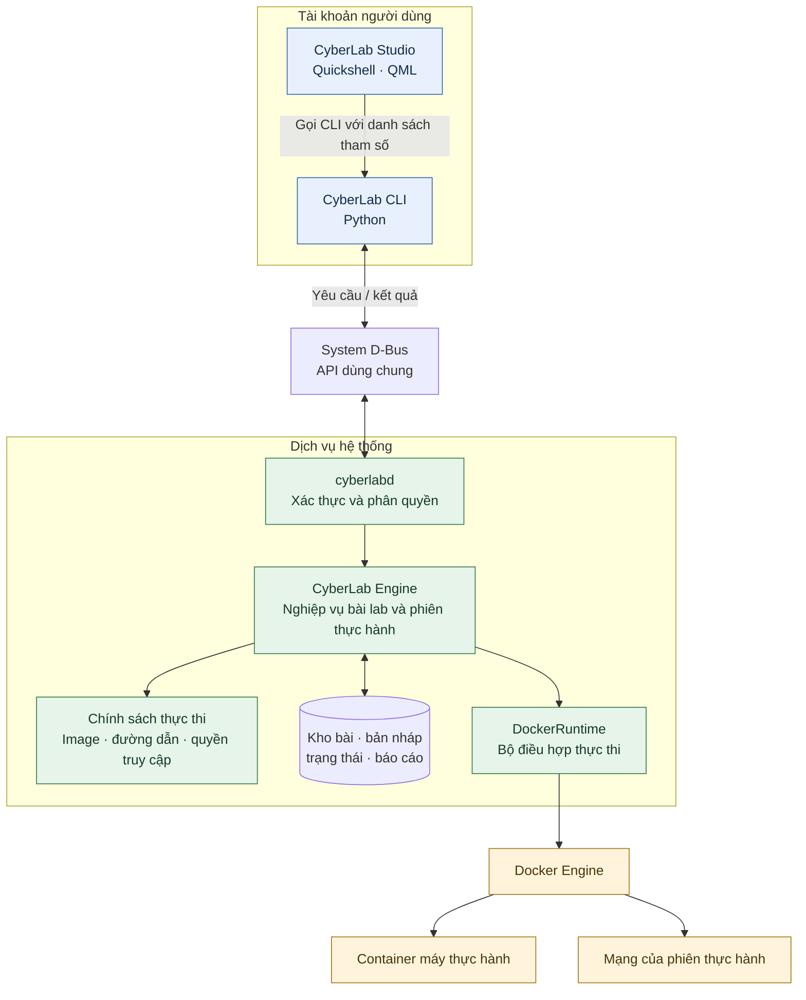
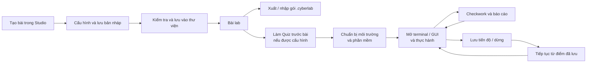
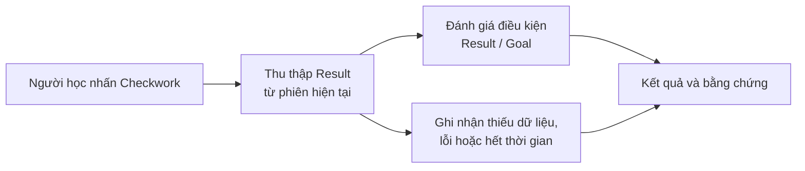

# CyberLab

**Tạo bài, thực hành và kiểm tra kết quả trong một ứng dụng Linux.**

CyberLab là đồ án tốt nghiệp xây dựng môi trường thực hành Linux, mạng máy tính
và an toàn thông tin dựa trên container. Người biên soạn cấu hình bài bằng giao
diện; người học mở bài, làm Quiz, thao tác trên các máy thực hành và dùng
Checkwork để kiểm tra kết quả.

> CyberLab đang được phát triển. Các kiểm thử cách ly không thay thế kiểm thử
> Docker thật hoặc cài đặt trên máy sạch. Phạm vi đã kiểm chứng và các giới hạn
> được ghi riêng trong tài liệu kiểm thử.

## Mục lục

- [Chức năng chính](#chức-năng-chính)
- [Kiến trúc hệ thống](#kiến-trúc-hệ-thống)
- [Luồng sử dụng](#luồng-sử-dụng)
- [Quiz, Result, Goal và Checkwork](#quiz-result-goal-và-checkwork)
- [Cài đặt và cập nhật](#cài-đặt-và-cập-nhật)
- [Dữ liệu và bảo mật](#dữ-liệu-và-bảo-mật)
- [Cấu trúc mã nguồn](#cấu-trúc-mã-nguồn)
- [Phát triển và kiểm thử](#phát-triển-và-kiểm-thử)
- [Tài liệu chuyên sâu](#tài-liệu-chuyên-sâu)

## Chức năng chính

| Nhóm          | Khả năng                                                                                        |
| ------------- | ----------------------------------------------------------------------------------------------- |
| Thư viện      | Tìm kiếm, lọc theo chủ đề và độ khó; xem hướng dẫn; nhập và xuất bài.                           |
| Biên soạn     | Tạo và sửa bài, lưu bản nháp, cấu hình máy, tài khoản/nhóm, mạng, phần mềm và script khởi động. |
| Trình sửa tệp | Cây thư mục, tạo/đổi tên/nhập/xóa tệp, tô màu cú pháp và xem trước hướng dẫn Markdown.          |
| Thực hành     | Khởi chạy nhiều máy container, mở terminal, chạy ứng dụng GUI và thực hành kết nối mạng.        |
| Lưu tiến độ   | Lưu điểm khôi phục, tiếp tục bài và đặt lại môi trường theo thao tác được chọn.                 |
| Đánh giá      | Quiz, thu thập Result, đánh giá Goal, Checkwork và xuất báo cáo/bằng chứng.                     |
| Chia sẻ       | Xuất gói `.cyberlab`, nhập vào thư viện và bảo vệ thao tác chỉnh sửa bằng mật khẩu.             |

## Kiến trúc hệ thống

CyberLab tách giao diện, API đặc quyền, nghiệp vụ và hạ tầng thực thi. Studio và
CLI dùng chung API của daemon; không thành phần giao diện nào điều khiển Docker
trực tiếp.



### Trách nhiệm từng tầng

| Thành phần        | Trách nhiệm                                                                                    | Ranh giới                                                      |
| ----------------- | ---------------------------------------------------------------------------------------------- | -------------------------------------------------------------- |
| **Studio**        | Hiển thị thư viện, trình biên soạn và màn hình thực hành; quản lý tương tác người dùng.        | Không truy cập Docker socket hoặc tự ghi vào kho bài hệ thống. |
| **CLI**           | Chuyển thao tác thành yêu cầu API; hỗ trợ người dùng terminal và các tiến trình do Studio gọi. | Không tự triển khai nghiệp vụ Docker.                          |
| **cyberlabd**     | Tiếp nhận yêu cầu qua System D-Bus, kiểm tra tài khoản gọi và quyền sở hữu tài nguyên.         | Là điểm vào đặc quyền của các thao tác bài lab.                |
| **Engine**        | Kiểm tra định nghĩa, quản lý bản nháp/phiên, chuẩn bị phần mềm và thực hiện đánh giá.          | Không phụ thuộc Quickshell hay giao diện người dùng.           |
| **DockerRuntime** | Chuyển yêu cầu thực thi thành thao tác container, mạng và image.                               | Docker là hạ tầng nội bộ, không phải định dạng API công khai.  |

Các lệnh quản trị **cài đặt/cập nhật ứng dụng** có luồng riêng với xác thực quản
trị, khóa thao tác và phục hồi khi lỗi; không phải API thực hành của daemon.

### Các khái niệm dữ liệu

- **Lab:** mẫu bài gồm cấu hình máy, mạng, tài nguyên, hướng dẫn và tiêu chí đánh giá.
- **Draft:** bản nháp đang biên soạn; thay đổi chỉ trở thành bài trong thư viện sau khi lưu/publish phù hợp.
- **Session:** một phiên thực hành của người dùng từ Lab; dữ liệu làm bài không sửa ngược mẫu bài.
- **Checkpoint:** điểm khôi phục được lưu cho phiên; không đồng nghĩa với mẫu bài hay image phần mềm dùng chung.
- **Report:** kết quả đánh giá và bằng chứng thu thập tại một lần kiểm tra/nộp bài.

## Luồng sử dụng



1. **Biên soạn:** nhập thông tin bài, chủ đề, độ khó; thêm máy và cấu hình mạng,
   tài khoản, tệp, phần mềm, hướng dẫn, Quiz và tiêu chí chấm khi cần.
2. **Lưu vào thư viện:** hệ thống kiểm tra cấu hình và tài nguyên trước khi công bố.
   Người dùng không cần tự tạo cây thư mục bài ngoài ứng dụng.
3. **Bắt đầu:** trả lời Quiz trước bài nếu có, xem đáp án rồi chuyển sang thực hành.
   Không bắt buộc đạt điểm tuyệt đối mới được vào bài.
4. **Chuẩn bị môi trường:** phần mềm chưa được chuẩn bị sẽ được xử lý trước khi mở
   các terminal. Cài sẵn giúp giảm thời gian chờ ở bước này.
5. **Thực hành và đánh giá:** thao tác trên các máy, chạy Checkwork và xem kết quả;
   lưu tiến độ hoặc xuất báo cáo theo nhu cầu.

GUI ưu tiên đường hiển thị native X11/XWayland khi đáp ứng các kiểm tra của hệ
thống; Xpra là phương án dự phòng. Khả năng hiển thị phải được xác minh trên
phiên desktop thực tế, không suy ra chỉ từ việc gói phần mềm đã cài thành công.

## Quiz, Result, Goal và Checkwork

| Khái niệm     | Vai trò                                                                                      |
| ------------- | -------------------------------------------------------------------------------------------- |
| **Quiz**      | Câu hỏi kiến thức phục vụ chuẩn bị hoặc củng cố bài; tách biệt với kiểm tra trạng thái máy.  |
| **Result**    | Khai báo dữ liệu cần thu thập từ môi trường; có thể chỉ thu thập hoặc có điều kiện đánh giá. |
| **Goal**      | Khai báo mục tiêu và điều kiện tổng hợp dựa trên kết quả thu thập.                           |
| **Checkwork** | Thực hiện thu thập, đánh giá các tiêu chí đã cấu hình và tạo kết quả phản hồi.               |



**Thu thập thành công không tự có nghĩa là làm bài đúng.** Bài không có tiêu chí
chấm cần được phân biệt với bài đạt yêu cầu. Checkwork phục vụ phản hồi thực hành,
không được xem là hệ thống thi chống gian lận trên máy do người học toàn quyền quản trị.

## Cài đặt và cập nhật

### Yêu cầu môi trường

- Máy Linux hoặc máy ảo Linux có **systemd** và **System D-Bus** đang hoạt động.
- **Python 3.12 trở lên**, Docker Engine và Quickshell native **0.3.1 trở lên**,
  cùng các module Qt/QML mà bộ cài kiểm tra.
- Quyền quản trị qua `sudo` để cài dịch vụ và runtime hệ thống.
- Internet để tải nguồn, dependency và image chưa có; đủ dung lượng cho build,
  image, dữ liệu thực hành và bản sao phục hồi.

Ubuntu là mục tiêu chính của dự án. Có bộ điều hợp cho các trình quản lý gói
Linux khác, nhưng có bộ điều hợp **không đồng nghĩa** mọi phiên bản distro đã
được xác nhận hỗ trợ. Đặc biệt, cần kiểm tra nguồn cung cấp Quickshell native;
bộ cài không tự nâng hệ điều hành để giải quyết dependency thiếu.

Ưu tiên cài mới trên **Ubuntu 26.04 LTS và Debian 13**; giữ đường cài Arch.
**Ubuntu 24.04 / Linux Mint 22.x chưa có đường cài tự động đầy đủ** vì thiếu
Quickshell trong nguồn đã duyệt, không nên thêm PPA rồi coi là đã hỗ trợ.
Xem [bảng nền tảng và kết quả kiểm thử](docs/installation/platforms.md) trước khi
cài trên máy khác. Windows/macOS không chạy trực tiếp bộ cài Linux này.

```bash
curl -fsSL https://raw.githubusercontent.com/sownteedev/CyberLab/master/install.sh | bash
```

Chỉ chạy script từ nguồn bạn tin cậy. Bootstrap lấy snapshot của một commit
cụ thể trên `master`, build bằng tài khoản thường rồi cài vào vị trí hệ thống.
Source/build tạm không trở thành checkout trong thư mục cá nhân. Python và QML
cần để chạy ứng dụng vẫn nằm trong runtime đã cài.

> Lệnh trên dùng phiên bản đã có trên GitHub, không dùng thay đổi chưa push trên
> máy phát triển. README này không phải bằng chứng cài đặt đã đạt trên máy sạch;
> xem [hướng dẫn và giới hạn kiểm chứng](docs/installation/README.md).

### Cài từ checkout

Chạy tại thư mục gốc repo:

```bash
bash install.sh --plan       # Xem kế hoạch dependency
bash install.sh              # Cài ứng dụng và dịch vụ hệ thống
bash install.sh --check      # Kiểm tra môi trường, không thay đổi bản cài
```

Bộ cài hiển thị và yêu cầu xác nhận giao dịch dependency khi cần. Không tự thêm
repository bên thứ ba, nâng cấp toàn hệ điều hành hay thay Python hệ thống.
Tùy chọn nguồn Quickshell và kiểm tra Docker có quyền quản trị được giải thích
trong [hướng dẫn cài đặt](docs/installation/README.md).

### Mở ứng dụng

```bash
cyberlab info
cyberlab-studio
```

Cũng có thể mở **CyberLab Studio** từ menu ứng dụng. Chạy giao diện và CLI thực
hành bằng tài khoản thường, không dùng `sudo`.

### Chọn đúng cách cập nhật

| Nhu cầu                                     | Lệnh                       |
| ------------------------------------------- | -------------------------- |
| Kiểm tra bản trên GitHub                    | `cyberlab update --check`  |
| Tải và cài bản từ nhánh `master`            | `cyberlab update`          |
| Build và cài source hiện tại trong checkout | `bash install.sh --update` |

**Máy đang phát triển dùng `bash install.sh --update` để cài cả thay đổi chưa
push.** Lệnh `cyberlab update` không lấy những thay đổi local đó.

Trước khi cập nhật, lưu nội dung đang sửa, đóng Studio và dừng các phiên thực
hành đúng cách. Bộ cập nhật kiểm tra phiên của mọi tài khoản được phép, có khóa
chống chạy đồng thời, sao lưu/rollback và xác minh bản cài. Luồng cập nhật thông
thường không tự đóng cửa sổ, dừng bài, di chuyển kho bài hoặc nâng Qt/Docker.

## Dữ liệu và bảo mật

### Vị trí trên máy cài mới

| Nội dung                                             | Đường dẫn                          |
| ---------------------------------------------------- | ---------------------------------- |
| Runtime, môi trường Python riêng và metadata bản cài | `/usr/lib/cyberlab/`               |
| Cấu hình hệ thống                                    | `/etc/cyberlab/`                   |
| Kho bài                                              | `/var/lib/cyberlab/labs/`          |
| Bản nháp và trạng thái thực hành                     | `/var/lib/cyberlab/authoring/`     |
| Tải/build tạm và dữ liệu phục hồi của bộ cài         | Các thư mục riêng dưới `/var/tmp/` |

Tùy chọn giao diện cá nhân và tệp người dùng chủ động xuất có thể nằm trong home.
Máy cài cũ có kho ở vị trí khác tiếp tục dùng cấu hình đó; cập nhật không tự di
chuyển hoặc xóa kho cũ.

### Cấu trúc logic của một bài

```text
<lab-id>/
├── lab.yaml                   # Định nghĩa bài, máy, mạng và tiêu chí
└── assets/                    # Tài nguyên do tác giả thêm
    ├── docs/guide.md          # Hướng dẫn Markdown
    ├── editor/<node-id>/      # Tệp được tạo/sửa trong cây tài nguyên
    ├── files/<node-id>/       # Tài nguyên ánh xạ vào máy, tùy bài
    └── startup/<node-id>/
        └── start.sh          # Script khởi động nếu được cấu hình
```

Đây là cấu trúc để hiểu cách lưu trữ, **không phải hướng dẫn sửa trực tiếp kho
hệ thống**. Chỉ `lab.yaml` là tệp bắt buộc; các tài nguyên còn lại được tạo khi
cần. Cây tệp trong trình biên soạn chứa tài nguyên tác giả, không tự đưa các tệp
phát sinh lúc người học thực hành trở lại mẫu bài.

### Phạm vi bảo vệ

- Tài khoản thường thao tác qua daemon; không cần vào nhóm `docker`. Docker
  socket không được cung cấp cho giao diện hoặc các máy thực hành.
- Kho hệ thống dùng quyền truy cập riêng của root/daemon: thư mục `0700`, tệp
  nội bộ `0600`. Đây là bảo vệ bằng phân quyền, **không phải mã hóa dữ liệu tại chỗ**.
- Mật khẩu sửa bảo vệ thao tác biên soạn bài đã khóa. Nhập và thực hành không
  yêu cầu mật khẩu sửa; tệp được tác giả đưa vào máy cho người học vẫn đọc được.
- Gói `.cyberlab` xuất mới dùng định dạng `cyberlab-lab/v3`, không phải ZIP đổi
  đuôi. Định dạng riêng và checksum giúp tránh giải nén thông thường, phát hiện
  hỏng dữ liệu; **không phải mã hóa bảo mật mạnh hoặc chữ ký chống giả mạo**.
- Vẫn nhận gói CyberLab v1/v2; luồng chuyển đổi Labtainer là chức năng riêng,
  không cam kết tương thích toàn bộ tính năng của Labtainer.
- Không cam kết che giấu mã nguồn runtime hoặc chống người có quyền root,
  sửa chương trình hay tự phân tích định dạng gói.

## Cấu trúc mã nguồn

```text
CyberLab/
├── engine/          # Mô hình bài, nghiệp vụ, chính sách và runtime adapter
├── daemon/          # Dịch vụ cyberlabd, API D-Bus và cấu hình dịch vụ
├── cli/             # Lệnh cyberlab và tích hợp terminal/cập nhật
├── ui/              # Launcher và Studio QML
│   └── studio/
│       ├── services/ # Dịch vụ phía giao diện
│       ├── views/    # Các màn hình
│       ├── assets/   # Icon, thương hiệu và font đóng gói
│       └── testing/  # Kiểm thử giao diện
├── schemas/         # Schema định nghĩa bài theo phiên bản
├── tools/           # Cài đặt, cập nhật và các kiểm thử duy trì
├── docs/            # Tài liệu kỹ thuật và kết quả kiểm chứng
├── install.sh       # Điểm vào của bộ cài
└── pyproject.toml   # Khai báo package và dependency Python
```

Kho bài thật, bản nháp, checkpoint và Docker image **không thuộc repository**.
Các tài liệu cũ có thể tham chiếu `tests/` hoặc bài mẫu đã được lưu trữ ngoài
checkout; dùng [danh mục công cụ hiện tại](tools/README.md) để chọn kiểm thử.

## Phát triển và kiểm thử

### Môi trường phát triển

```bash
python3 -m venv .venv
.venv/bin/python -m pip install -e .
bash tools/run_studio.sh --require-native
```

Môi trường editable chỉ phục vụ phát triển Python, không tự cài daemon đặc
quyền hay dependency desktop. Lệnh mở Studio từ source kết nối **daemon thật**;
không dùng nó như môi trường giả lập để thử trên dữ liệu người dùng.

Thay đổi backend cần build và cập nhật runtime hệ thống bằng
`bash install.sh --update`. Daemon không chạy mã từ checkout người dùng có thể
ghi. Đọc [AGENTS.md](AGENTS.md) trước khi thay đổi kiến trúc hoặc chính sách triển khai.

### Một số kiểm thử cách ly

Trên máy đã cài runtime, chạy từ thư mục repo:

```bash
/usr/lib/cyberlab/venv/bin/python -B tools/tests/unit/check_session_state.py
/usr/lib/cyberlab/venv/bin/python -B tools/tests/unit/check_assessment_quiz.py
/usr/lib/cyberlab/venv/bin/python -B tools/tests/unit/check_result_collection.py
python3 -B tools/tests/ui/check_notifications.py --suite editor --native
```

Không chạy hàng loạt mọi test trong `tools/tests/` mà chưa đọc yêu cầu: một số công cụ
cần đầu vào riêng, Docker, quyền quản trị hoặc môi trường hiển thị tạm.

| Tầng kiểm thử             | Chứng minh được                                                         | Không thay thế                                |
| ------------------------- | ----------------------------------------------------------------------- | --------------------------------------------- |
| Python và runtime giả lập | Logic dữ liệu, hợp đồng API, lỗi và phục hồi trong tình huống mô phỏng. | Container, mạng và phần mềm Linux thật.       |
| QML cách ly/offscreen     | Component tải được và các tương tác được kiểm thử.                      | Trải nghiệm desktop và độ mượt thực tế.       |
| Wheel đóng gói            | Module/tài nguyên có trong artifact và các bước kiểm tra bản đóng gói.  | Cài mới trên mọi distro.                      |
| Kiểm thử xuyên suốt       | Tạo → chạy → chấm → lưu/tiếp tục trong môi trường đã thử.               | Các môi trường chưa có bằng chứng kiểm chứng. |

Chỉ dùng dữ liệu thử riêng. Không lấy catalog, bản nháp hoặc phiên thật làm
fixture; không đưa secret, bài cá nhân, image máy ảo hay artifact tạm vào Git.

## Tài liệu chuyên sâu

Xem [mục lục tài liệu](docs/README.md): kiến trúc, cài đặt, tạo bài, thực hành,
đánh giá, chia sẻ bài, Studio và phát triển. Báo cáo kiểm thử lịch sử được
tách riêng, không trộn vào hướng dẫn hiện hành.
