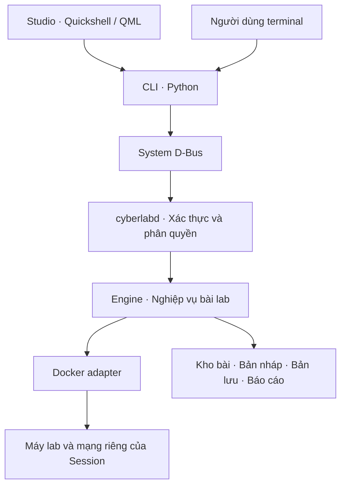

# Kiến trúc CyberLab

CyberLab là ứng dụng desktop để tạo, phân phối và thực hành bài lab Linux.
Người dùng thao tác trong Studio hoặc CLI; Docker là thành phần thực thi bên
dưới, không phải giao diện quản trị dành cho người học.

## Luồng xử lý

Studio gọi CLI không đặc quyền với danh sách đối số rõ ràng. Cả hai sử dụng
cùng hợp đồng D-Bus; giao diện không được gọi Docker trực tiếp. Lệnh quản trị
cài đặt/cập nhật là luồng riêng có xác thực hệ thống, không phải API chạy bài.

## Phân chia trách nhiệm

| Thành phần | Trách nhiệm | Không thực hiện |
| --- | --- | --- |
| `ui/` | Hiển thị, soạn bài, điều hướng, tùy chọn cá nhân | Truy cập Docker hoặc tự quyết định quyền |
| `cli/` | Gọi daemon, kết nối terminal, nhập/xuất do người dùng yêu cầu | Đọc trực tiếp kho bài riêng |
| `daemon/` | System D-Bus, danh tính người gọi, vòng đời dịch vụ | Tin UID hoặc quyền do client tự khai |
| `engine/` | Lab, bản nháp, Session, phần mềm, Quiz, Checkwork | Phụ thuộc QML hoặc thực thi mã chấm tùy ý trên host |
| `schemas/` | Cấu trúc khai báo và ràng buộc phiên bản | Thay thế kiểm tra chính sách runtime |
| `tools/` | Cài đặt, bảo trì và kiểm thử có phạm vi rõ ràng | Dùng dữ liệu thật làm fixture |

## Mô hình dữ liệu

| Khái niệm | Ý nghĩa |
| --- | --- |
| **Lab** | Mẫu bài: cấu hình máy/mạng, tệp ban đầu, hướng dẫn và tiêu chí đánh giá |
| **Draft** | Bản nháp riêng của tác giả; có revision và có thể chưa hợp lệ |
| **Session** | Một lần thực hành với bản chụp cấu hình Lab tại lúc khởi tạo |
| **Checkpoint** | Trạng thái đã lưu để tiếp tục Session, không phải bản sửa của Lab |
| **Report** | Kết quả Checkwork/Quiz và bằng chứng tại một lần đánh giá |
| **Software image** | Môi trường phần mềm có thể tái sử dụng, tách khỏi dữ liệu cá nhân |

Sửa bài trong thư viện không âm thầm thay cấu hình của Session đã tồn tại.
Lưu bản nháp không đồng nghĩa với xuất bản; lưu thực hành không đồng nghĩa với
lưu bản nháp. Các luồng này có kiểm tra quyền và vòng đời riêng.

## Lưu trữ trên máy

Máy cài mới đặt runtime ở `/usr/lib/cyberlab/`, cấu hình ở `/etc/cyberlab/`,
kho bài ở `/var/lib/cyberlab/labs/` và dữ liệu bản nháp/thực hành dưới
`/var/lib/cyberlab/authoring/`. Kho bài do daemon quản lý; tài khoản thường
thao tác qua API thay vì sửa tệp trực tiếp.

Bản cài cũ có thể vẫn trỏ tới kho trong home. Cập nhật ứng dụng không tự di
chuyển kho đó. Xem [cài đặt và quản trị](../installation/README.md).

## Ranh giới an toàn

- Không cấp Docker socket hoặc nhóm Docker cho người học; không mount socket
  vào máy lab.
- Máy lab không chạy `privileged`; tài nguyên, image, mạng và tệp đều qua chính sách.
- UID chủ Session là UID người gọi trên host; tài khoản Linux trong node là
  cấu hình khác, không cấp quyền cho tài khoản host.
- Bản nháp dùng ownership, revision và digest để chống ghi đè phản hồi cũ.
- Mật khẩu sửa là khóa thao tác tác giả, không phải mã hóa gói hoặc cơ chế
  chống người có quyền root. Xem [chia sẻ và bảo vệ bài](../distribution/README.md).
- Native X11/XWayland có ranh giới khác Xpra; xem
  [an toàn hiển thị](../practice/display-security.md).

## Điểm tra cứu trong mã nguồn

| Nội dung | Nguồn |
| --- | --- |
| Điều phối nghiệp vụ | [`engine/cyberlab/service.py`](../../engine/cyberlab/service.py) |
| Mẫu bài và chuyển đổi gói | [`engine/cyberlab/lab/`](../../engine/cyberlab/lab/) |
| Bản nháp và xuất bản | [`engine/cyberlab/authoring/`](../../engine/cyberlab/authoring/) |
| Chính sách / adapter | [`engine/cyberlab/policy/`](../../engine/cyberlab/policy/), [`engine/cyberlab/runtime/`](../../engine/cyberlab/runtime/) |
| Schema Lab | [`schemas/v1/lab.schema.json`](../../schemas/v1/lab.schema.json) |
| Chữ ký D-Bus | [`org.ptit.CyberLab1.xml`](../../daemon/cyberlab_ipc/org.ptit.CyberLab1.xml) |

Schema và mã nguồn là nơi xác định trường/giới hạn chính xác. Tài liệu giải
thích hợp đồng và cách dùng, không chép lại toàn bộ schema thành bản thứ hai.

**Đọc tiếp:** [Tạo bài](../authoring/README.md) · [Studio](../studio/README.md) ·
[Phát triển và kiểm thử](../development/README.md).
