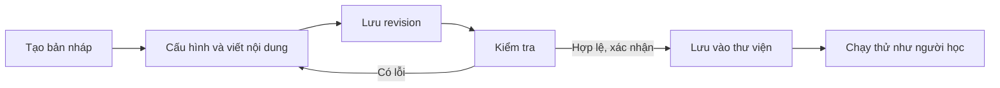

# Tạo và chỉnh sửa bài lab

Tác giả tạo máy, mạng, tệp, phần mềm và tiêu chí đánh giá trong Studio.
Không cần tự viết Dockerfile hoặc sửa thư mục bài ngoài ứng dụng.
CLI dùng cùng API để kiểm thử/tự động hóa, không phải luồng bắt buộc với người dùng.

## 1. Một bài hoàn chỉnh gồm gì?

| Nội dung | Khi nào cần? |
| --- | --- |
| Tổng quan | Mã bài, tên, phiên bản, chủ đề và độ khó |
| Máy lab | Ít nhất một máy và môi trường chạy hợp lệ |
| Mạng | Khi cần kết nối giữa máy hoặc truy cập bên ngoài |
| Hướng dẫn | Mục tiêu, tình huống, nhiệm vụ và cách kiểm tra kết quả |
| Tệp ban đầu / script | Khi kịch bản cần dữ liệu hoặc khởi tạo riêng |
| Phần mềm | Các package/ứng dụng mà người học sẽ sử dụng |
| Quiz | Ôn kiến thức trước hoặc trong khi thực hành, nếu tác giả muốn |
| Result–Goal | Chấm tự động khi bài có kết quả quan sát được |

Hướng dẫn nên đủ để người khác tự làm: điều kiện bắt đầu, nhiệm vụ theo bước,
kết quả mong đợi và lưu ý khi reset. Không bắt mọi bài có script hoặc Quiz;
không tạo tệp rỗng chỉ để đủ một cây thư mục.

Studio yêu cầu chọn chủ đề và độ khó cho bài mới. Độ khó có ba giá trị
`easy`, `medium`, `hard`; bài cũ thiếu trường này vẫn đọc được và hiển thị chưa
phân loại. Không tự gán độ khó khi mở bài cũ.

## 2. Quy trình soạn bài



1. Tạo bản nháp, nhập tổng quan và phân loại.
2. Thêm máy, chọn môi trường và tài khoản; thiết lập mạng/phần mềm ở
   [cấu hình máy lab](machines.md).
3. Tạo tệp trực tiếp trên cây thư mục, viết hướng dẫn và script nếu cần.
4. Khai báo [Quiz và Checkwork](../assessment/README.md) với kết quả dự kiến rõ ràng.
5. Lưu, kiểm tra rồi xác nhận xuất bản hoặc cập nhật bài đang sửa.
6. Thử bài chưa làm, làm sai, làm đúng; kiểm tra cả lưu/tiếp tục/reset.

Bản nháp có thể chưa hợp lệ nhưng vẫn cần lưu được để làm tiếp. Xuất bản chỉ
thực hiện với revision và digest đã kiểm tra. Kiểm tra schema/chính sách không
khẳng định image đã tải, account tồn tại hoặc dịch vụ thực sự khởi động được.

## 3. Cấu trúc bài được ứng dụng tạo

Đây là cấu trúc logic trong kho do daemon quản lý, không phải yêu cầu người
dùng tự mở `/var/lib/cyberlab/labs/` để sửa:

```text
<lab-id>/
├── lab.yaml
└── assets/
    ├── docs/guide.md
    ├── files/<node-id>/...
    ├── editor/<node-id>/...
    └── startup/<node-id>/start.sh
```

Chỉ `lab.yaml` bắt buộc. Các asset phát sinh khi tác giả thêm nội dung; đường
dẫn cụ thể có thể khác ở bài nhập hoặc bài cũ. `lab.yaml` tham chiếu asset,
không dựa vào việc một thư mục có tên cố định để tự suy ra chức năng.

Session, ảnh Docker, checkpoint, tệp người học tạo và khóa GUI sinh lúc chạy
không thuộc cây mẫu bài này. Xem [định dạng gói](../distribution/package-format.md)
khi cần biết dữ liệu được mang theo lúc xuất.

## 4. Trình soạn tệp

- Cây bên trái chứa tài nguyên tác giả; menu ngữ cảnh hỗ trợ tạo, đổi tên,
  nhập và xóa. Chọn tệp để mở tab chỉnh sửa.
- Màu cú pháp chỉ hỗ trợ đọc/viết; không xác minh mã sẽ chạy đúng.
- Hướng dẫn Markdown có bản xem trước; tệp nhị phân không được coi như văn bản.
- Tệp ban đầu được ánh xạ vào máy; chỉnh asset không thay tệp của Session đang chạy.
- Tạo/đổi tên/xóa phải cập nhật tham chiếu liên quan hoặc bị từ chối nếu không
  an toàn; không chấp nhận `..`, symlink vượt vùng quản lý hoặc đường dẫn host tùy ý.

### Home và System là hai mục đích khác nhau

**Home:** dữ liệu học tập, mã nguồn, cấu hình người dùng. Đích tương đối với
home của tài khoản node; không tự thêm thư mục `lab/`:

```yaml
files:
  - source: assets/files/client/answer.txt
    target: answer.txt
```

Với home `/home/learner`, tệp xuất hiện ở `/home/learner/answer.txt`.
Đích thư mục `.` chép nội dung vào gốc workspace, chỉ dùng cho nguồn thư mục
và phải là ánh xạ duy nhất của máy để tránh chồng lấn. Node legacy không cấu
hình user sử dụng workspace `/tmp/lab`. Không mount home của host vào node.

**System:** tệp và quyền Unix phục vụ cấu hình máy Ubuntu, qua `node.setup`
và danh sách đường dẫn/quyền được kiểm tra. Đây không phải quyền ghi tùy ý vào
hệ thống host. Xem [tài khoản và tệp hệ thống](machines.md).

Nhập tệp vào Session đang chạy là thao tác khác với nhập asset vào bản nháp:
nó không cập nhật mẫu bài, không tự tồn tại sau reset.

## 5. Script khởi động

Không cần script nếu lệnh mặc định của môi trường đã đủ. Khi bật script,
Studio tạo asset, ánh xạ vào máy và khai báo lệnh chạy tương ứng. Có thể viết
trong editor hoặc nhập `.sh`; shell phải có trong image. Lệnh tùy chỉnh của
bài cũ được giữ lại, không âm thầm đổi khi mở form.

Script chạy trong node theo chính sách môi trường, không chạy trên host khi
kiểm tra, nhập gói hoặc xuất bản. Không dùng script tùy ý để vượt cơ chế setup
tài khoản/quyền đã được kiểm soát.

## 6. Lưu, bỏ sửa và xung đột

| Thao tác | Tác động |
| --- | --- |
| Lưu bản nháp | Lưu nội dung riêng, chưa thay bài trong thư viện |
| Bỏ thay đổi chưa lưu | Bỏ phần đang sửa ở editor, không xóa bài đã xuất bản |
| Xuất bản mới | Thêm một ID mới; không ghi đè ID đang có |
| Cập nhật bài | Áp dụng bản đã xác nhận vào bài nguồn; Session cũ giữ bản chụp riêng |
| Xóa bản nháp | Xóa bản nháp được chọn, không xóa bài nguồn |

Daemon kiểm tra ownership và revision trên từng thao tác. Nếu revision đã
thay đổi, phải đọc/đối chiếu lại; không ghi đè bằng phản hồi đến muộn. Lưu lỗi
không được xóa nội dung editor hoặc báo thành công. Đổi máy/đổi bài phải bỏ
qua callback của đối tượng trước đó.

Mật khẩu sửa được quản lý riêng với nội dung đang soạn. Đổi mật khẩu có hiệu
lực ngay; bỏ sửa nội dung không hoàn tác việc đổi mật khẩu. Chi tiết ở
[bảo vệ quyền tác giả](../distribution/README.md).

## 7. Ranh giới xuất bản

Xuất bản là lưu vào thư viện **trên máy này**, không tải lên một server cộng
đồng. Bản nháp vẫn riêng theo chủ sở hữu. Lưu/cập nhật bài không bắt đầu phiên
thực hành hoặc cài phần mềm ngầm chỉ để xác nhận form.

Máy đích khi nhập bài vẫn cần image/phần mềm được chính sách cho phép; một
gói `.cyberlab` hợp lệ không chứng minh bài đó chạy được trên mọi máy.

**Đọc tiếp:** [Máy, mạng và phần mềm](machines.md) ·
[Thực hành](../practice/README.md) · [Chia sẻ bài](../distribution/README.md).
