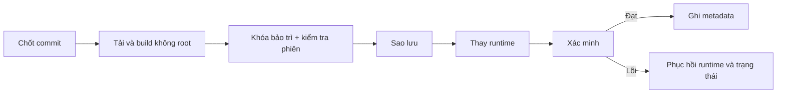

# Cài đặt, cập nhật và quản trị

Hướng dẫn dành cho máy Linux có desktop, systemd và System D-Bus. Trước khi
cài, đọc [nền tảng hỗ trợ](platforms.md): có adapter cho một distro không có
nghĩa mọi phiên bản của distro đó đã được nghiệm thu.

## 1. Yêu cầu

- Python từ 3.12 cho runtime, Quickshell native từ 0.3.1 và bộ Qt/QML tương thích.
- Docker Engine hệ thống; không thay bằng Podman hoặc tự cấp quyền Docker cho user.
- Quyền quản trị qua terminal để cài package, dịch vụ và cấu hình hệ thống.
- Kết nối mạng khi tải source/dependency/image chưa có; dung lượng đủ cho build,
  image, bản lưu và rollback.
- Chạy Studio bằng tài khoản desktop thường, không dùng `sudo cyberlab-studio`.

Bộ cài không tự nâng hệ điều hành, thay Qt, tắt SELinux/AppArmor hoặc thêm
nguồn package ngoài sự chấp thuận. Sau khi đổi kernel, nếu thiếu module của
kernel đang chạy, cần khởi động lại theo chẩn đoán trước khi cài tiếp.

## 2. Cài mới

### Từ GitHub, không clone vào home

```bash
curl -fsSL https://raw.githubusercontent.com/sownteedev/CyberLab/master/install.sh | bash
```

Chỉ chạy script từ nguồn bạn tin cậy. Bootstrap cần `curl`, Python 3, HTTPS và
terminal cho `sudo`; adapter tiếp tục kiểm tra phiên bản Python/runtime cần thiết.
HTTPS và cố định commit không phải chữ ký độc lập của nhà phát hành.

Lệnh lấy bản đã có trên `master`, **không lấy thay đổi local chưa push**. Kết quả
thử từ checkout không thay thế phép thử chính lệnh curl trên máy sạch.

### Từ checkout phát triển

```bash
bash install.sh --plan
bash install.sh
cyberlab info
cyberlab-studio
```

Nếu chạy từ root shell, chỉ định tài khoản desktop bằng `--user NAME`.
Nếu kho đang bật thiếu Quickshell, xem và chấp thuận nguồn được hỗ trợ:

```bash
bash install.sh --plan --enable-quickshell-repo
bash install.sh --enable-quickshell-repo
```

Qua link, truyền cờ bằng `bash -s -- --enable-quickshell-repo`. Cờ này chấp
thuận nguồn bên thứ ba; `--yes` riêng lẻ không cấp quyền thêm nguồn. Khóa ký
được kiểm tra fingerprint; không ghi đè file nguồn có nội dung khác.
Ubuntu 24.04/Mint 22.x còn giới hạn Quickshell nêu trong [bảng nền tảng](platforms.md).

### Các chế độ cần phân biệt

| Lệnh/cờ | Mục đích |
| --- | --- |
| `--plan` | Xem kế hoạch, không thay package hoặc dịch vụ |
| `--check` | Kiểm tra môi trường native/QML, không triển khai |
| `--deps-only` | Chuẩn bị dependency hệ thống, không cài dịch vụ/kho CyberLab |
| `--no-deps` | Cài ứng dụng với dependency đã được chuẩn bị |
| `--allow-dependency-upgrades` | Chấp thuận giao dịch nâng dependency đã xem xét; không phải nâng toàn OS |
| `--update` | Cập nhật ứng dụng đang cài từ checkout này |

Xpra là fallback tùy khả năng kho gói; thiếu Xpra không chặn toàn bộ Studio.
Nếu đồng thời không có native display dùng được thì GUI trong node không hoạt
động. Cập nhật bằng giao diện cần `pkexec` và polkit agent của phiên desktop;
bộ cài không tự lựa chọn hoặc thay agent của người dùng.

## 3. Vị trí cài đặt

| Thành phần | Đường dẫn mặc định trên máy mới |
| --- | --- |
| Runtime / virtualenv | `/usr/lib/cyberlab/venv/` |
| Metadata bản cài | `/usr/lib/cyberlab/installation.json` |
| CLI / launcher | `/usr/local/bin/cyberlab`, `/usr/local/bin/cyberlab-studio` |
| Menu ứng dụng | `/usr/share/applications/cyberlab-studio.desktop` |
| Cấu hình daemon | `/etc/cyberlab/daemon.toml` |
| Kho bài | `/var/lib/cyberlab/labs/` |
| Bản nháp / thực hành | `/var/lib/cyberlab/authoring/` |
| Source/build tạm, log và phục hồi | Thư mục riêng dưới `/var/tmp/` |

Kho mới khởi đầu rỗng, thư mục riêng `0700`, tệp nội bộ `0600`. Installer
không thêm bài mẫu hoặc tự chạy Session để nghiệm thu. Python/QML cần chạy
vẫn nằm trong runtime; đây không phải cách mã hóa mã nguồn ứng dụng.
Tùy chọn cá nhân, cache của giao diện và tệp chủ động xuất có thể nằm trong home.

## 4. Cập nhật đúng nguồn

| Bạn muốn lấy bản nào? | Lệnh |
| --- | --- |
| Kiểm tra bản GitHub | `cyberlab update --check` |
| Cập nhật từ `master` trên GitHub | `cyberlab update` |
| Cài những sửa đổi đang có trong checkout | `bash install.sh --update` |

Trước khi thay runtime: lưu nội dung soạn bài, đóng Studio và đưa Session của
mọi tài khoản được phép về `STOPPED`. Không dùng updater để cưỡng ép dừng bài.
Tác vụ chuẩn bị phần mềm đang chạy cũng chặn thay runtime.

Kiểm tra cập nhật so sánh quan hệ commit, không chỉ so hai SHA khác nhau. Chỉ
quảng bá bản mới khi đích đi trước bản cài. Local đi trước, nhánh phân kỳ hoặc
không xác minh được quan hệ không được coi là có bản mới. Bản cài local không
có commit đáng tin cậy hiển thị **chưa xác định**, không báo nhầm mới nhất.

Trong **Cài đặt → Cập nhật**, Studio gọi cùng luồng quản trị. Cửa sổ updater
riêng tiếp tục chạy sau khi Studio đóng đúng quy trình. Phần trăm chỉ dùng
cho tải xuống có tổng kích thước; build/cài/xác minh dùng trạng thái đang xử lý,
không tạo phần trăm tổng giả. Thành công phải khớp cả mã thoát và receipt trước
khi đề nghị khởi động lại ứng dụng. Mật khẩu hệ thống đi qua polkit, không do
Studio đọc hoặc lưu.

## 5. Giao dịch và phục hồi



- Snapshot và helper thuộc cùng commit; archive bị kiểm tra đường dẫn, liên
  kết, kích thước và kiểu tệp. Build/cache tạm không đặt trong home.
- Khóa installer và maintenance lease ngăn cập nhật trùng hoặc khởi tạo phiên
  mới giữa bước kiểm tra và thay runtime.
- Cập nhật không gọi trình quản lý package OS, không sửa catalog, mật khẩu,
  allowlist image hoặc tự di chuyển dữ liệu.
- Sau thay runtime, kiểm tra dependency, daemon/CLI, danh tính catalog,
  checkpoint và biên dịch QML. Biên dịch QML không phải nghiệm thu GUI tương tác.
- Dọn source/build tạm; giữ log riêng và dữ liệu rollback cần thiết. Cơ chế mới
  chỉ quản lý backup do chính nó đánh dấu, không dọn backup cũ không liên quan.

Nếu lỗi, giữ đường dẫn backup được in ra và đọc `install.log` cùng
`journalctl -u cyberlabd`. Không thử lại liên tục, xóa database hoặc ghép venv
cũ với database mới. Mất điện, SIGKILL hoặc lỗi phục hồi có thể cần quản trị
viên xử lý. Giao dịch package OS khi cài mới không được rollback như venv.
Backup chứa dữ liệu riêng; không công khai hoặc đổi quyền để đính kèm báo lỗi.

## 6. Quản trị bản cài cũ

### Daemon chưa hỗ trợ maintenance lease

Updater từ chối thay một daemon cũ đang chạy vì chưa khóa được thao tác đồng
thời. Chỉ sau khi xác nhận không còn phiên/công việc đang chạy, quản trị viên
mới dừng daemon rồi chạy `bash install.sh --update --offline`. Chế độ này yêu
cầu daemon đã dừng, không còn container quản lý và Session lưu đều `STOPPED`;
không phải lệnh để vượt kiểm tra phiên.

### Chuyển kho home vào hệ thống

Đây là thao tác riêng, không nằm trong cập nhật thông thường:

```bash
sudo /usr/bin/python3 -E tools/admin/migrate_catalog.py --uid "$(id -u)"
```

Cần daemon có `maintenance-lock-v1`, Studio đã đóng và các phiên đã dừng.
Công cụ từ chối đích có sẵn, kiểm tra hash sau sao chép, áp quyền riêng, đổi
cấu hình và kiểm chứng daemon; có rollback cấu hình nếu kích hoạt lỗi.
**Không xóa kho home cũ.** Chỉ dọn bản cũ sau nghiệm thu và quyết định riêng.

**Đọc tiếp:** [Nền tảng đã thử](platforms.md) ·
[Bằng chứng kiểm thử](../archive/README.md) · [Phát triển](../development/README.md).
